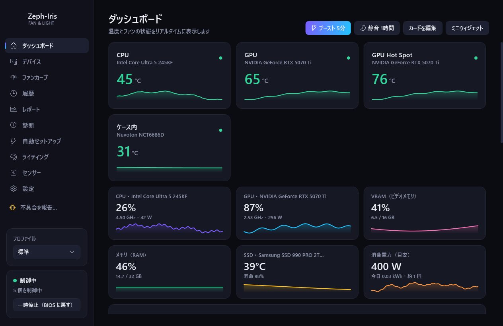
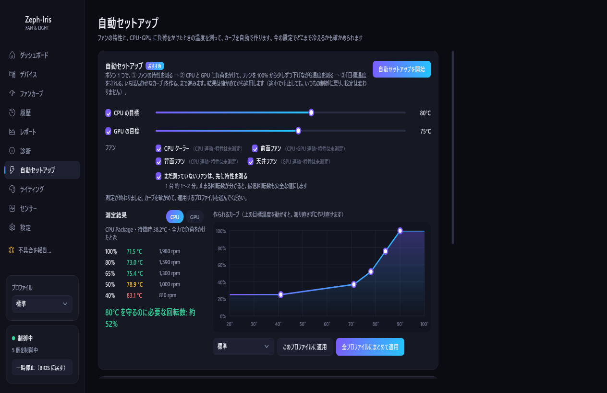
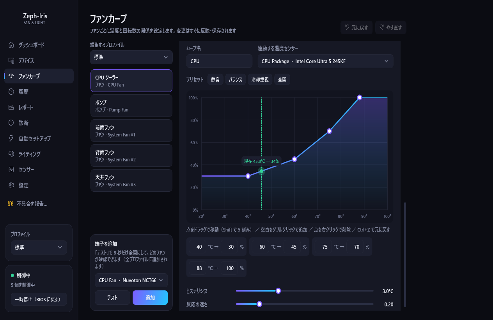
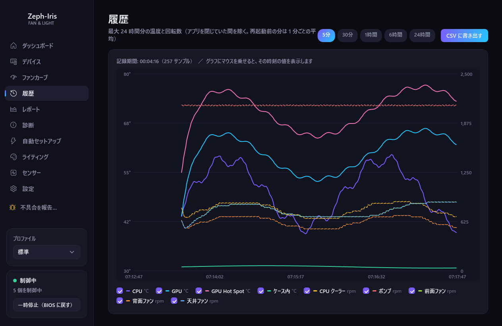
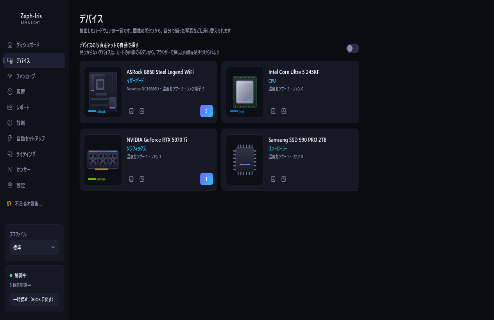

<p align="center"></p>

<h1 align="center">Zeph-Iris</h1>

<p align="center"><b>Windows のデスクトップ PC のファンを、静かに・安全に。LED も光らせる。設定はボタン 1 つ。</b></p>

<p align="center">
  <a href="../../releases/latest"></a>
  <a href="../../actions/workflows/ci.yml"></a>
  <a href="LICENSE"></a>
  
  
</p>

<p align="center"><a href="README.md">English</a> | <b>日本語</b></p>

<p align="center"></p>

**Zeph-Iris**（ゼフィリス）は、西風の神ゼピュロス（ファン）と虹の女神イリス（LED）から名付けました。マザーボードのファン端子を温度に合わせて制御し、PC を見張り、LED を温度・レインボー・音楽に合わせて光らせます。

- **ボタン 1 つの自動セットアップ** — ファンを 1 つずつ測り、CPU とグラボに負荷をかけて、目標温度を守れるいちばん静かなカーブを作ります。適用する前に結果を確かめられます。
- **安全第一** — 緊急全開、センサーの異常値の除外、ポンプの見張り、アプリが落ちたら起動し直す見張りプロセス、終了・スリープ時は BIOS 制御に戻す。
- **音楽連動の LED** — キック・スネアの検出とテンポの追従。実際の曲を録音して調整しました。12 種類の光り方（OpenRGB と連携）。
- **アカウントなし・テレメトリーなし** — [プライバシーポリシー](PRIVACY.md) を見てください。

> 6.6.1 までの名前は **ProFanController**、6.7.0〜6.7.3 の名前は **Fanlume** です。設定と記録は引き継げます（「[Fanlume・ProFanController から移るとき](#fanlumeprofancontroller-から移るとき)」を見てください）。

> 個人で作ったツールです。ファンやポンプの制御を誤ると、部品が熱くなりすぎることがあります。ご利用は自己責任でお願いします（LICENSE の「無保証」のとおりです）。

## 画面

| 自動セットアップ | ファンカーブ |
|---|---|
|  |  |
| **履歴** | **デバイス** |
|  |  |

<sub>画面の写真は、作り物のハードウェア（`Tests/Screenshots`）で撮っています。実際の PC の情報は写っていません。</sub>

## できること

- **ファン制御**: 温度カーブ・目標温度・固定値・ほかのファンへの連動。複数の温度センサー、ヒステリシス、回転の上がり下がりの速さ、共振する回転数を避ける設定
- **自動セットアップ**: ボタン 1 つで、ファンごとの特性（止まる・回り出す回転数）を測り、CPU とグラボに負荷をかけてファンを少しずつ下げ、静かで安全なカーブを作る。測ったときより室温が 5°C 以上上がったら、測り直しをおすすめします
- **安全機能**: 緊急全開、センサーの異常値の除外・固着の検知、ポンプの回転の見張り、見張りプロセス（本体が落ちたらファンを安全な回転数にして起動し直す）、終了・スリープ時は BIOS 制御に戻す
- **監視・記録**: ダッシュボード、履歴、電気代の目安、ファンの劣化・ホコリの検知、異常の前後の記録
- **LED（OpenRGB 連携）**: 温度・レインボー・呼吸・固定色・音楽連動（キック・スネアの検出、テンポの追従、12 種類の光り方）。デバイス・端子（ゾーン）ごとの設定と色合わせ。PNY ARGB Epic-X のグラボは OpenRGB を通さず直接書き込み
- **そのほか**: プロファイルの自動切り替え、スマホからの確認（同じネットワーク内）、ntfy / Discord への通知、タスクトレイ常駐・ログオン時の自動起動、サイドバーとトレイの「不具合を報告…」、18 言語の画面表示

> 画面の表示は 18 言語に対応しています（日本語・英語・中国語〈簡体字・繁体字〉・韓国語・ロシア語・ウクライナ語・ドイツ語・フランス語・スペイン語・イタリア語・ポルトガル語〈ブラジル〉・ポーランド語・オランダ語・トルコ語・ベトナム語・タイ語・インドネシア語）。Windows の表示言語に合わせて選ばれ、設定 →「見た目」→「表示言語」で変えられます。日本語以外は新しく訳したもので、ぎこちない言い回しが残っているかもしれません。直し方は「[翻訳](#翻訳)」を見てください。

## 必要なもの

- Windows 10 / 11（64bit）のデスクトップ PC
- [PawnIO](https://pawnio.eu/)（ファンの制御用の署名つきドライバー。LibreHardwareMonitor 0.9.6 以降で必要）。インストーラーに PawnIO の公式のインストーラーが入っていて、自動で入れます
- 管理者権限（Super I/O にアクセスするため、起動時に UAC の確認が出ます）
- LED を使う場合: [OpenRGB](https://openrgb.org/)（起動しておき、SDK サーバーをオンにする）

ノート PC と、ファン制御に対応していないマザーボードでは使えません。

## 動作確認済みの環境（ベータ版）

開発と動作確認は、次の PC で行っています（対応機種の一覧ではなく、確かめた例です）。

| 部品 | 型番 |
|---|---|
| OS | Windows 11 Pro（64bit） |
| マザーボード | ASRock B860 Steel Legend WiFi（Super I/O: Nuvoton NCT6686D） |
| CPU | Intel Core Ultra 5 245KF |
| グラボ | PNY GeForce RTX 5070 Ti 16GB ARGB Epic-X OC |

構成の違うもう 1 台の PC でも、PawnIO のインストール・Lian Li のファン・不具合の報告まで動くことを確かめました。

ほかのマザーボード・グラボでも、[LibreHardwareMonitor](https://github.com/LibreHardwareMonitor/LibreHardwareMonitor)（ファン・温度）と OpenRGB（LED）が対応している部品なら動きます。ただし、機種ごとの仕様やセンサーの並びによって、動きが違うことがあります。うまく動かないときは、お使いの部品の型番を添えて知らせてください。

対応していない・確かめていない部品のときの動き:

- **ファン端子が見つからないマザーボード**: ファンの一覧が空になり、温度・使用率の監視だけになります。ファンには何も書き込まず、BIOS の制御のままです
- **PawnIO が入っていない**: ファン端子と一部の温度（CPU など）を読めません。セットアップの画面から入れられます
- **書き込みが反映されないマザーボード**（ほかのソフトがチップを使っているなど）: 書いた値と実際の値を毎回比べ、反映されないときは書き直して知らせます
- **ファンが回らない・温度が読めない・固まる**: 値がおかしいセンサーは全開、センサーごと無くなったときは安全側の固定値にします。CPU・GPU が緊急温度に達したら（カーブで使っていない温度でも）全ファンを全開にします
- **グラボの LED の直接書き込み**: 上の型番だけです。ほかのグラボは OpenRGB を通して光らせます（ライティング →「詳細」で、確かめていない型番でも試せます）
- **グラボのファンの制御**: 既定ではオフです（設定でオンにしたときだけ）

## 使い方（インストーラー）

1. [Releases](../../releases/latest) から `Zeph-Iris-<版>-setup.exe` をダウンロードして実行する。`C:\Program Files\Zeph-Iris` に入り、スタートメニューにも登録されます。まだコード署名をしていないため（SignPath での署名を準備中です。「[コード署名の方針](CODE_SIGNING.md)」）、「Windows によって PC が保護されました」と出たら、「詳細情報」→「実行」を押してください
2. 最後の画面の「Zeph-Iris を実行する」はチェックしたままにする。PawnIO（ファン制御に使うドライバー）が入っていなければ、インストーラーに入っている PawnIO の公式のインストーラーで入れます
   （うまくいかないときは、アプリのフォルダーの「1_PawnIO をインストール.bat」を右クリック →「管理者として実行」するか、[公式サイト](https://pawnio.eu/)のインストーラーを使う）
3. はじめの設定の案内に沿ってファン端子に名前を付け、「自動セットアップ」の画面で **自動セットアップを開始** を押す（約 20〜30 分。測っているあいだは PC を触らずにおく）

詳しくは、アプリのフォルダーにある「はじめにお読みください.txt」（英語は `README_en.txt`。このリポジトリでは `Distribution/` の中）を見てください。新しい版への更新は、アプリの設定 →「一般」→「アップデート」→「更新する」を押すだけです（6.7.1 から）。新しいインストーラーをダウンロードし、GitHub に公開されたものと同じか（大きさ・SHA-256）を確かめてから、画面を出さずに入れ替えます。新しいインストーラーを手で実行してもかまいません。どちらも、動いている Zeph-Iris を正しく終了してから（そのあいだファンは BIOS の設定で回ります）入れ替え、設定・記録はそのまま残ります。

使うのをやめるときは、Windows の「設定」→「アプリ」→「インストールされているアプリ」からアンインストールします（Zeph-Iris を終了し、ログオン時の自動起動・ファイアウォールの許可などを消して、設定・記録も消すかを尋ねます）。アプリの設定 →「安全・バックアップ」→「アンインストール（お片付け）」からも行えます。こちらは PawnIO のアンインストールも選べ、最後にアンインストーラーを実行します。

### Fanlume・ProFanController から移るとき

Zeph-Iris のインストーラーを一度だけ手で実行します（Fanlume 6.7.1〜6.7.3 の「更新する」は、新しい名前の版を見つけられません）。動いている Fanlume・ProFanController は、先に正しく終了させます。Zeph-Iris をはじめて起動すると、次のことを行います。

- `C:\Program Files\Fanlume`（なければ `C:\Tools\ProFanController`）の設定と記録を写す
- ログオン時の自動起動とスマホ監視用のファイアウォールの許可を、新しい名前に切り替える
- Fanlume を、設定・記録を残すよう伝えて、Fanlume のアンインストーラーで外す（「インストールされているアプリ」から前の名前が消えます）

前のフォルダーには設定の写しが残るので、Zeph-Iris が動くのを確かめてから削除してください。前の版で書き出した設定ファイル（`*.fanlume.json`・`*.profan.json`）も読み込めます。

## ソースからのビルド

.NET 8 SDK が必要です。インストーラーを作るには [Inno Setup 6](https://jrsoftware.org/isinfo.php) も必要です（`winget install JRSoftware.InnoSetup`）。

```powershell
# 動作確認（Release でビルドして起動）
dotnet build -c Release
# ロジックのテスト
dotnet run -c Release --project Tests/LogicTests
# インストーラーを作る（.NET ランタイムごと exe 1 つに発行し、Distribution の中身と一緒に Installer/Zeph-Iris.iss でまとめる）
powershell -ExecutionPolicy Bypass -File Distribution/make-dist.ps1
```

`Properties/PublishProfiles` に発行のプロファイルが 2 つあります。

- `Portable`: .NET ランタイムごと 1 つの exe（配布用。make-dist.ps1 が使う）
- `SingleExe`: .NET 8 デスクトップランタイムが入っている PC 用の軽い exe

一番上の `config.json` は開発用の見本です（ビルドしたときの出力フォルダーにだけ写され、配布用には入りません）。

## フォルダーの構成

| 場所 | 中身 |
|---|---|
| `Core/` | ファン制御のエンジン、センサー、設定、OpenRGB との通信、LED の描画（`Core/Rgb`） |
| `Audio/`・`Core/Audio/` | 音楽連動の音の取り込みと分析（帯域・キック・テンポ） |
| `UI/`・`MainWindow*` | 画面（WPF） |
| `Tests/LogicTests/` | ロジックのテスト（画面・実機なしで動く） |
| `Tests/Screenshots/` | README の画面写真を作る（作り物のハードウェアで本物の画面を動かす。`dotnet run --project Tests/Screenshots -c Release -- <フォルダー> ja`） |
| `.github/workflows/` | CI（`ci.yml`）と、署名つきのリリースのビルド（`release.yml`。[CODE_SIGNING.md](CODE_SIGNING.md)） |
| `Distribution/` | アプリと一緒に入れる説明書（日本語・英語）・バッチ・ライセンスと、インストーラーを作るスクリプト |
| `Installer/` | インストーラーの Inno Setup のスクリプト（`Zeph-Iris.iss`） |
| `Assets/Lang/` | 画面の言葉の翻訳表（言語ごとに 1 ファイル）と、元の文の一覧（`keys.tsv`） |
| `tools/` | 開発用の道具（同梱フォントの文字を絞る `FontSubset`、訳す文を一覧にする `LocTool` など。アプリには入らない） |

## 翻訳

画面の言葉は、ソースコードに日本語で書き、`Assets/Lang/<言語>.txt`（`en.txt`・`de.txt` など）から訳を引いています。1 行に「日本語の文のハッシュ・タブ・訳」を書きます。改行は `\n` と書き、`{0}` や `{1:F0}` のような差し込みはそのまま残してください。`keys.tsv` には、元の文・ハッシュ・使っている場所の一覧があります。

- 訳を直すときは、その言語のファイルの行を書き換えます。ロジックのテスト（`Tests/LogicTests` の `TestTranslationTables`）で、どの行も今ある文に対応していること・差し込みがそろっていることを確かめられます。
- コードの文を変えたら、`dotnet run --project tools/LocTool -- extract` で `keys.tsv` を作り直し、`-- missing <言語>` でまだ訳していない文を一覧にします。
- 訳がない文は日本語のまま表示されるので、行が足りなくてもアプリは壊れません。

## 不具合の報告

サイドバーのいちばん下（またはタスクトレイのアイコンのメニュー）の **不具合を報告…** を押してください。ログ・設定・見つけた部品の一覧を PC の中で zip にまとめ、[Issues](../../issues/new/choose) のページを開きます。zip の中身を確かめて添付してください。自動では何も送りません。動作を確かめたのはまだ 2 台だけなので、ほかの部品での報告はとても助かります。

## プライバシーとコード署名

- [プライバシーポリシー](PRIVACY.md): アカウントもテレメトリーもありません。アプリが自分から通信するのは GitHub（新しい版の確認）と Wikimedia Commons（デバイスの写真）だけで、どちらも止められます。
- [コード署名の方針](CODE_SIGNING.md): SignPath の審査が通ったら、リリースに署名します。

## 謝辞

Zeph-Iris は、次のオープンソースのおかげで動いています。作って、育ててくださっている皆さんに感謝します。

- [LibreHardwareMonitor](https://github.com/LibreHardwareMonitor/LibreHardwareMonitor) — 温度を読み、ファン端子を動かします
- [PawnIO](https://pawnio.eu/) — LibreHardwareMonitor がハードウェアに触れるためのドライバーです
- [OpenRGB](https://openrgb.org/) — LED を光らせます。PNY Epic-X のグラボの色を書き込む場所も、OpenRGB の調査を参考にしました（Zeph-Iris は OpenRGB と SDK の通信でやり取りしていて、OpenRGB のコードは含んでいません）
- [NAudio](https://github.com/naudio/NAudio) — 音楽連動の音を取り込みます
- [QRCoder](https://github.com/codebude/QRCoder) — スマホ監視の QR コードを作ります
- [Montserrat](https://github.com/JulietaUla/Montserrat)・[Zen Maru Gothic](https://github.com/googlefonts/zen-marugothic) — 画面のフォントです
- [Inno Setup](https://jrsoftware.org/isinfo.php) — インストーラーを作ります
- [.NET](https://github.com/dotnet)・WPF

## ライセンス

Zeph-Iris は [MIT License](LICENSE) です。使っている部品（LibreHardwareMonitorLib は MPL-2.0、NAudio・QRCoder・.NET は MIT、フォントは SIL Open Font License 1.1 など）のライセンスは [CREDITS.txt](CREDITS.txt) にまとめています。インストーラーは Inno Setup で作っています。OpenRGB・PawnIO・Ollama はこのリポジトリに含まず、別に入れて使います。
