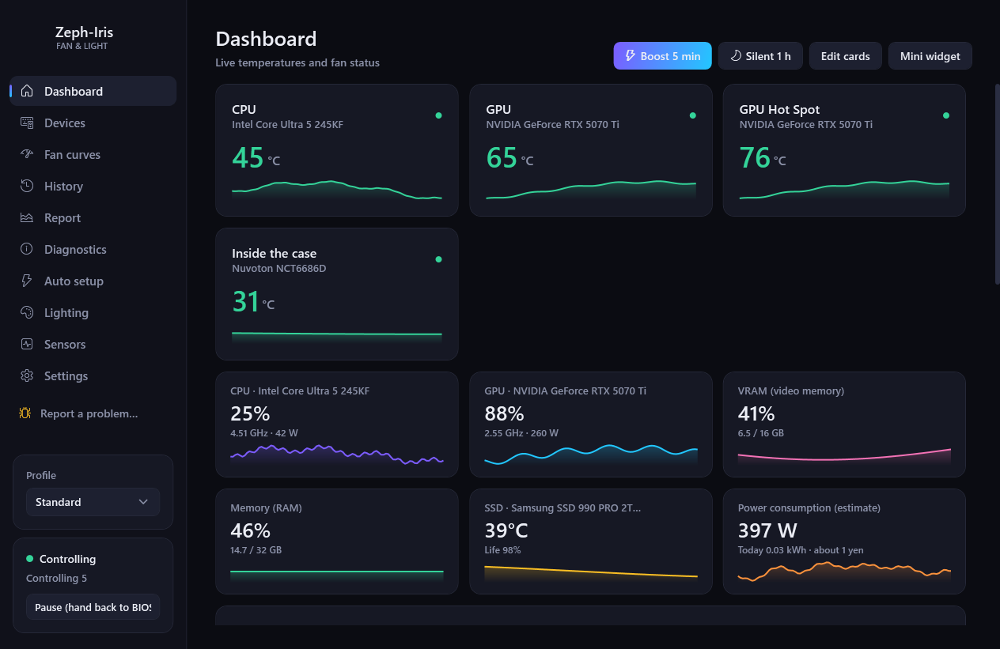
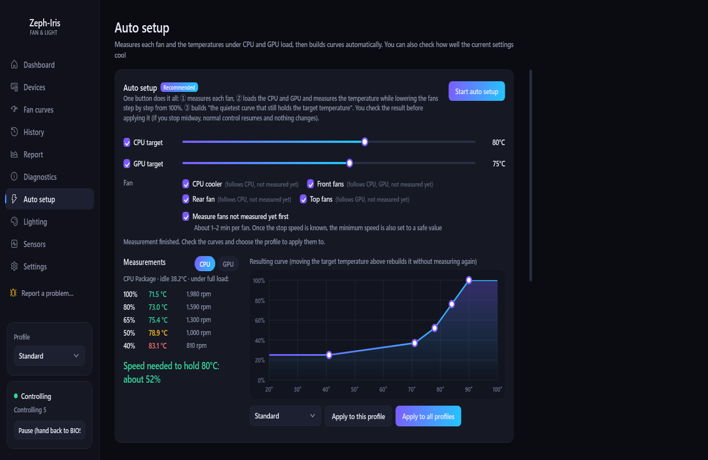
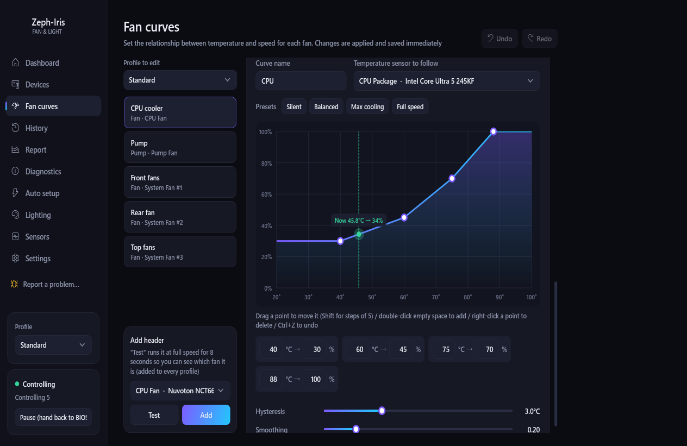
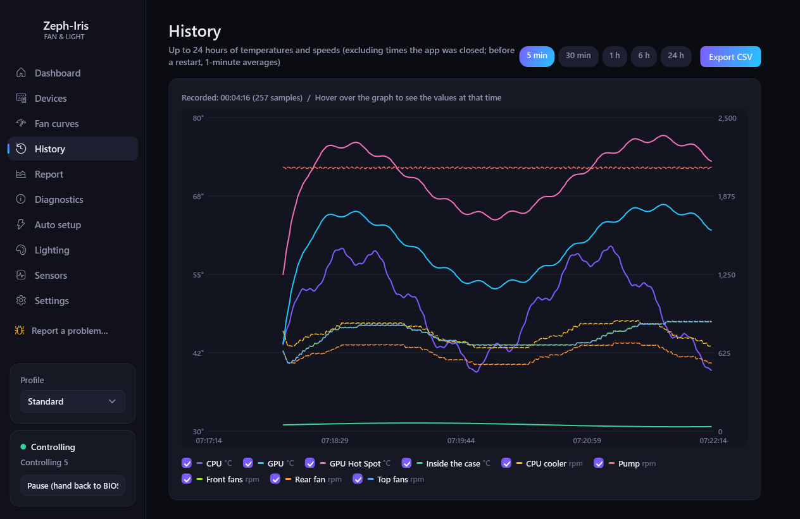
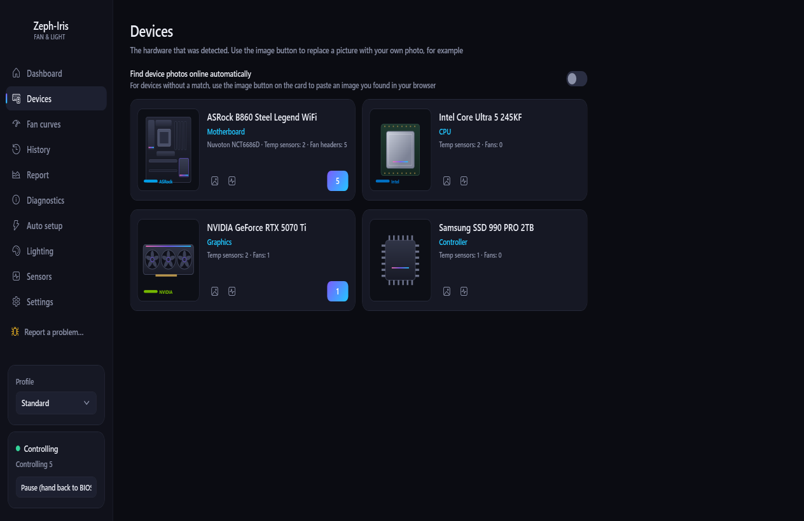

<p align="center"></p>

<h1 align="center">Zeph-Iris</h1>

<p align="center"><b>Quiet, safe fan control and LED lighting for Windows desktop PCs — set up in one click.</b></p>

<p align="center">
  <a href="../../releases/latest"></a>
  <a href="../../actions/workflows/ci.yml"></a>
  <a href="LICENSE"></a>
  
  
</p>

<p align="center"><b>English</b> | <a href="README.ja.md">日本語</a></p>

<p align="center"></p>

**Zeph-Iris** — after Zephyr, the west wind (the fans), and Iris, the rainbow (the LEDs). It drives your motherboard's fan headers from temperatures, watches over the PC, and lights the LEDs with temperature, rainbow or music sync.

- **One-button auto setup** — measures every fan, loads the CPU and GPU, and builds the quietest curve that still holds your target temperature. You check the result before it is applied.
- **Safe by design** — emergency full speed, bad-sensor filtering, pump watch, a watchdog that restarts the app, and fans handed back to the BIOS on exit or sleep.
- **Music sync lighting** — kick and snare detection and beat tracking, tuned on recorded songs; a dozen styles, with OpenRGB.
- **No account, no telemetry** — see the [privacy policy](PRIVACY.md).

> This app was called **ProFanController** up to 6.6.1 and **Fanlume** from 6.7.0 to 6.7.3. Settings and records carry over (see [Moving from Fanlume or ProFanController](#moving-from-fanlume-or-profancontroller)).

> This is a personal project. Wrong fan or pump control can let parts get too hot. Use it at your own risk (see the "no warranty" clause in the LICENSE).

## Screenshots

| Auto setup | Fan curves |
|---|---|
|  |  |
| **History** | **Devices** |
|  |  |

<sub>Screenshots are made with simulated hardware (`Tests/Screenshots`), so they show no real PC's details.</sub>

## Features

- **Fan control**: temperature curves, target temperature, fixed duty, following another fan. Several sensors per curve, hysteresis, ramp-up/down rates, and resonance bands to skip
- **Auto setup**: one button measures each fan (stop and start speeds), then loads the CPU and GPU and lowers the fans step by step to build the quietest safe curve. When the room gets 5°C or more warmer than when you measured, the app suggests measuring again
- **Safety**: emergency full speed (also watches the CPU and GPU temperatures when no curve uses them), filtering of bad sensor values and stuck sensors, pump speed watch, a watchdog process (sets safe fan speeds and restarts the app if it crashes), and handing the fans back to the BIOS on exit and sleep
- **Monitoring and diagnostics**: dashboard, history, electricity estimate, fan wear and dust checks that compare like with like (room temperature and fan-curve changes are taken into account), and a flight recorder for incidents
- **LEDs (with OpenRGB)**: temperature, rainbow, breathing, static colour and music sync (kick and snare detection, beat tracking, a dozen styles), per device and per zone. Music sync can listen to one app only (for example Spotify). PNY ARGB Epic-X graphics cards are written directly, without OpenRGB
- **Switching from another app**: import curves and fan names from FanControl, and a warning (with how to fix it) when vendor software such as Armoury Crate, iCUE or L-Connect fights over the same fans or LEDs
- **Other**: automatic profile switching, a phone view on the same network, ntfy / Discord notifications, tray icon and start at logon, "Report a problem" in the sidebar and tray menu, and a user interface in 18 languages
- **Optional**: an AI cooling advisor using a local [Ollama](https://ollama.com/) model (off by default; turn it on at the top of the Diagnostics page; your data stays on the PC)

> **The user interface is available in 18 languages**: English, Japanese, Chinese (Simplified and Traditional), Korean, Russian, Ukrainian, German, French, Spanish, Italian, Portuguese (Brazil), Polish, Dutch, Turkish, Vietnamese, Thai and Indonesian. It follows the Windows display language; to choose another one, go to Settings → Appearance → Language. The original text is Japanese and the other languages are new translations, so some wording may read unnaturally; corrections are welcome (see [Translations](#translations)).

## Requirements

- A Windows 10 / 11 (64-bit) desktop PC
- [PawnIO](https://pawnio.eu/) (the signed driver used for fan control; required by LibreHardwareMonitor 0.9.6 and later). The installer includes the official PawnIO installer and sets it up for you
- Administrator rights (needed for the Super I/O chip; Windows asks for confirmation at start)
- For LEDs: [OpenRGB](https://openrgb.org/) (if it is installed in Program Files, Zeph-Iris starts it with the SDK server on when it is not running; start an OpenRGB unpacked from a zip yourself and turn on its SDK server)

Laptops and motherboards without fan control support are not supported.

## Verified environment (beta)

The app is developed and tested on this PC. This is an example that has been checked, not a list of supported hardware.

| Part | Model |
|---|---|
| OS | Windows 11 Pro (64-bit) |
| Motherboard | ASRock B860 Steel Legend WiFi (Super I/O: Nuvoton NCT6686D) |
| CPU | Intel Core Ultra 5 245KF |
| Graphics card | PNY GeForce RTX 5070 Ti 16GB ARGB Epic-X OC |

It has also been checked on a second, different PC (including the PawnIO setup, Lian Li fans and the problem report).

Other motherboards and graphics cards work as long as [LibreHardwareMonitor](https://github.com/LibreHardwareMonitor/LibreHardwareMonitor) (fans and temperatures) and OpenRGB (LEDs) support them, but behaviour can differ with each model's specifics and sensor layout. If something does not work, please report it with your hardware models.

What happens with unsupported or unchecked parts:

- **No fan headers found**: the fan list is empty and the app only monitors temperatures and load. Nothing is written to the fans; the BIOS stays in control
- **PawnIO missing**: fan headers and some temperatures (such as the CPU) cannot be read. It can be installed from the setup screen
- **Writes do not take effect** (another program is using the chip, for example): every write is read back; if it does not stick, the app writes again and tells you
- **A fan stops, or a sensor fails or freezes**: a sensor with bad values sets its fans to full speed; a sensor that disappears sets a safe fixed speed. If the CPU or GPU reaches the emergency temperature, all fans go to full speed
- **Direct LED writes to graphics cards**: only for the model above. Other cards are lit through OpenRGB (you can try unchecked models under Lighting → Advanced)
- **Graphics card fan control**: off by default (only when you turn it on in Settings)

## Getting started (installer)

1. Download `Zeph-Iris-<version>-setup.exe` from [Releases](../../releases/latest) and run it. It installs to `C:\Program Files\Zeph-Iris` and adds a Start menu entry. The installer is not code-signed yet (signing through SignPath is being prepared, see [Code signing policy](CODE_SIGNING.md)), so Windows may show "Windows protected your PC": press "More info" → "Run anyway"
2. Leave "Launch Zeph-Iris" ticked on the last page. If PawnIO (the fan control driver) is not installed, the installer installs it with the official PawnIO installer it contains
   (if that fails: right-click `1_PawnIO をインストール.bat` ("install PawnIO") in the app folder → Run as administrator, or use the installer from the [official site](https://pawnio.eu/))
3. Follow the first setup to name your fan headers, then press **Start auto setup** on the Auto setup page (about 20–30 minutes; leave the PC alone while it measures)

See `README_en.txt` in the app folder (in this repository under `Distribution/`) for details. To update, use Settings → General → Updates → "Update" in the app (from 6.7.1 on): it downloads the new installer, checks it against the file published on GitHub (size and SHA-256), and replaces the app without any screens. You can also run the newer installer yourself. Either way the running Zeph-Iris is closed properly (the fans go back to the BIOS settings for a moment) and settings and records are kept.

To stop using the app, uninstall it from Windows Settings → Apps → Installed apps (it closes Zeph-Iris, removes the logon start and the firewall rule, and asks whether to delete settings and records), or use Settings → Safety & backup → Uninstall (clean up) in the app, which also offers to uninstall PawnIO and then runs the uninstaller.

### Moving from Fanlume or ProFanController

Run the Zeph-Iris installer once by hand (the "Update" button in Fanlume 6.7.1–6.7.3 does not find the new name). It closes a running Fanlume or ProFanController properly first. When Zeph-Iris starts for the first time, it:

- copies the settings and records from `C:\Program Files\Fanlume` (or `C:\Tools\ProFanController`);
- moves the logon start and the firewall rule for the phone view to the new name;
- uninstalls Fanlume with its own uninstaller, keeping its settings and records, so the old name leaves Installed apps.

The old folder keeps a copy of the settings; delete it once you have checked Zeph-Iris works. Settings files exported by the earlier versions (`*.fanlume.json`, `*.profan.json`) can still be imported.

## Building from source

Requires the .NET 8 SDK. Building the installer also needs [Inno Setup 6](https://jrsoftware.org/isinfo.php) (`winget install JRSoftware.InnoSetup`).

```powershell
# Build and run (Release)
dotnet build -c Release
# Logic tests
dotnet run -c Release --project Tests/LogicTests
# Installer (publishes one exe including the .NET runtime, adds the contents of Distribution, and builds Installer/Zeph-Iris.iss)
powershell -ExecutionPolicy Bypass -File Distribution/make-dist.ps1
```

`Properties/PublishProfiles` has two publish profiles:

- `Portable`: one exe including the .NET runtime (for distribution; used by make-dist.ps1)
- `SingleExe`: a small exe for PCs that have the .NET 8 Desktop Runtime

The `config.json` at the top is a development sample (copied to the build output only, not into the release).

## Repository layout

| Path | Contents |
|---|---|
| `Core/` | fan control engine, sensors, settings, OpenRGB communication, LED rendering (`Core/Rgb`) |
| `Audio/`, `Core/Audio/` | music sync: audio capture and analysis (bands, kicks, tempo) |
| `UI/`, `MainWindow*` | user interface (WPF) |
| `Tests/LogicTests/` | logic tests (run without the UI or hardware) |
| `Tests/Screenshots/` | makes the README screenshots by running the real window on simulated hardware (`dotnet run --project Tests/Screenshots -c Release -- <folder> en`) |
| `.github/workflows/` | CI (`ci.yml`) and the signed release build (`release.yml`, see [CODE_SIGNING.md](CODE_SIGNING.md)) |
| `Distribution/` | guides (Japanese and English), a batch file and licences installed with the app, and the script that builds the installer |
| `Installer/` | the Inno Setup script for the installer (`Zeph-Iris.iss`) |
| `Assets/Lang/` | translation tables for the user interface (one file per language) and the list of source texts (`keys.tsv`) |
| `tools/` | development tools (for example `FontSubset`, which trims the bundled font, and `LocTool`, which lists the texts to translate; not part of the app) |

## Translations

The texts on screen are written in Japanese in the source code and looked up in `Assets/Lang/<language>.txt` (for example `en.txt`, `de.txt`). Each line holds the hash of the Japanese text, a tab and the translation; a line break is written as `\n`, and placeholders such as `{0}` or `{1:F0}` must be kept as they are. `keys.tsv` lists every source text with its hash and where it is used.

- To fix a translation, edit the line in the language file. The logic tests (`Tests/LogicTests`, test `TestTranslationTables`) check that every line belongs to a current text and keeps its placeholders.
- After changing texts in the code, run `dotnet run --project tools/LocTool -- extract` to update `keys.tsv`, and `-- missing <language>` to list what still needs translating.
- Texts with no translation are shown in Japanese, so a missing line never breaks the app.

## Reporting problems

Press **Report a problem…** at the bottom of the sidebar (or in the tray icon's menu). It packs the logs, settings and the list of detected parts into a zip on your PC and opens the [issue](../../issues/new/choose) page; check the zip and attach it. Nothing is sent automatically. So far the app has been checked on two PCs, so reports from other hardware help a lot.

## Privacy and code signing

- [Privacy policy](PRIVACY.md): no account and no telemetry. On its own the app only contacts GitHub (update check) and Wikimedia Commons and Openverse (device photos), and both can be turned off.
- [Code signing policy](CODE_SIGNING.md): releases will be signed through SignPath once the application is accepted.

## Thanks

Zeph-Iris stands on the shoulders of these open-source projects. Many thanks to everyone who builds and maintains them:

- [LibreHardwareMonitor](https://github.com/LibreHardwareMonitor/LibreHardwareMonitor) — reads the temperatures and drives the fan headers
- [PawnIO](https://pawnio.eu/) — the driver that gives LibreHardwareMonitor access to the hardware
- [OpenRGB](https://openrgb.org/) — lights the LEDs; its research on the PNY Epic-X graphics card also showed where to write that card's colours (Zeph-Iris talks to OpenRGB over its SDK protocol and contains no OpenRGB code)
- [NAudio](https://github.com/naudio/NAudio) — captures the sound for music sync
- [QRCoder](https://github.com/codebude/QRCoder) — the QR code for the phone view
- [Montserrat](https://github.com/JulietaUla/Montserrat) and [Zen Maru Gothic](https://github.com/googlefonts/zen-marugothic) — the fonts
- [Inno Setup](https://jrsoftware.org/isinfo.php) — the installer
- [.NET](https://github.com/dotnet) and WPF

## How Zeph-Iris is made

The code is written with [Claude Code](https://claude.com/claude-code), an AI coding assistant. The author decides what to build and how it should behave, tests every change on real hardware (fans, pumps, LEDs and music sync are checked by eye and ear), reviews the results, and decides each release. Logic tests, a UI test in six languages and a translation check run on every change in CI.

If something looks wrong, please say so in an [issue](../../issues/new/choose); reports from real PCs are what this project is built on.

## License

Zeph-Iris is under the [MIT License](LICENSE). Licences of the components it uses (LibreHardwareMonitorLib: MPL-2.0; NAudio, QRCoder, .NET: MIT; fonts: SIL Open Font License 1.1; and others) are listed in [CREDITS.txt](CREDITS.txt). The installer is built with Inno Setup. OpenRGB, PawnIO and Ollama are not included in this repository; install them separately.
